# Quickshell Architecture & System Setup Guide

This document provides a comprehensive technical breakdown of this custom **Quickshell** desktop environment setup: the underlying technologies it is built upon, the external system files it touches, its full dependency graph, and the internal mechanics of how it functions.

---

## Table of Contents
1. [Overview & Core Architecture](#1-overview--core-architecture)
2. [What It Is Built On](#2-what-it-is-built-on)
3. [External Files Touched & Integration Seams](#3-external-files-touched--integration-seams)
4. [System Dependencies & Services](#4-system-dependencies--services)
5. [How It Works (Internal Mechanics)](#5-how-it-works-internal-mechanics)
6. [Component Map & Screen Geometry](#6-component-map--screen-geometry)
7. [Troubleshooting & Maintenance](#7-troubleshooting--maintenance)

---

## 1. Overview & Core Architecture

This setup replaces the default Omarchy desktop shell (`/usr/share/omarchy/shell`) with a native, high-performance, modular desktop shell built directly on **Quickshell**. 

Rather than using a single static top bar, the shell employs an **island-based design language** featuring single-vector curved "scoop" contours anchored to physical screen edges. Every bar and popout operates within a shared in-process QML runtime, delivering instant animations, zero-IPC state coordination, and seamless Wayland layer-shell compositing.

```mermaid
flowchart TD
    subgraph Compositor ["Wayland Compositor (Hyprland 0.56+)"]
        HL_Binds["hyprland.lua / bindings.lua<br/>(Keybinds & Dispatchers)"]
        HL_Layers["looknfeel.lua<br/>(X-Ray Blur Layer Rules)"]
        HL_Autostart["autostart.lua<br/>(qs --no-duplicate)"]
        HL_IPC["Hyprland IPC Socket<br/>(Workspaces, Monitors, Windows)"]
    end

    subgraph Shims ["System Interception Seams (~/.local/bin)"]
        S_Vol["omarchy-audio-output-volume"]
        S_Bri["omarchy-brightness-display"]
        S_Menu["omarchy-menu / omarchy"]
        S_Shell["omarchy-shell"]
    end

    subgraph Core ["Quickshell Engine (qs / Qt6 QML)"]
        Shell["shell.qml (Root Scope)"]
        Theme["Theme.qml (Live TOML Colors)"]
        Popouts["PopoutCoordinator.qml (Mutual Exclusion)"]
        Variants["BarVariants.qml (Monitor Targeting)"]
        Scoop["ScoopV2.qml / ScoopContour.qml (Vector Shapes)"]
    end

    subgraph Panels ["Island Panels & HUDs"]
        WS["WorkspaceBar.qml (Top-Left)"]
        Time["TimeBar.qml (Top-Center)"]
        Wifi["WifiBar.qml (Top-Right)"]
        BT["BluetoothBar.qml (Top-Right)"]
        Audio["AudioBar.qml (Center-Left)"]
        Bat["BatteryBar.qml (Center-Right)"]
        Menu["OmarchyMenu.qml (Bottom-Center)"]
        Notif["NotificationPanel.qml (Bottom-Right)"]
        Picker["WallpaperPicker.qml (Overlay)"]
        Overlay["RoundedOverlay.qml (Screen Corners)"]
    end

    HL_Autostart -->|Spawns| Core
    HL_Binds -->|global shortcuts| Core
    HL_IPC <-->|Events & Queries| WS
    HL_Layers -->|Translucent X-Ray Blur| Panels

    S_Vol -->|qs ipc call audioBar| Audio
    S_Bri -->|qs ipc call brightnessBar| Panels
    S_Menu -->|qs ipc call menu| Menu
    S_Shell -->|osd / toggle events| Core

    Shell --> WS & Time & Wifi & BT & Audio & Bat & Menu & Notif & Picker & Overlay
    Theme -.-> Panels
    Popouts -.-> Panels
    Variants -.-> Panels
    Scoop -.-> Panels
```



---

## 2. What It Is Built On

The system is constructed on top of several native Linux graphics and Wayland specifications:

### 2.1 Quickshell Runtime (`qs 0.3.1`)
- **Language**: Modern QML (Qt 6.7+ Declarative) with inline JavaScript logic.
- **Process Model**: A single persistent client process (`/usr/bin/qs`) managing all windows, timers, D-Bus listeners, and subprocesses concurrently.
- **Zero-Webview Footprint**: Unlike Electron or web-wrapper bars (such as Waybar with CSS hacks, Eww, or AGS), Quickshell uses native C++ QtQuick scenegraph rendering, achieving sub-millisecond response times and minimal memory usage.

### 2.2 Wayland Layer Shell Protocol (`wlr-layer-shell-unstable-v1`)
- All surfaces are instantiated as `PanelWindow` components bound to `WlrLayershell`.
- Uses `WlrLayer.Overlay` for floating HUDs, popouts, and menu surfaces to guarantee rendering above standard application windows without disrupting window tiling.
- Uses `ExclusionMode.Ignore` so floating islands do not force window manager resizes or steal layout space from tiled clients.
- Uses `Region { item: ... }` masking to restrict input capture exclusively to the visible vector boundary, ensuring 100% mouse click-through across the rest of the display.

### 2.3 Mathematical Vector Geometry (`QtQuick.Shapes`)
- Panel backgrounds are not sliced bitmaps or rectangular CSS boxes with borders.
- They are generated mathematically via `ScoopContour.qml` using `PathArc` and `PathLine` rendered by `Shape.CurveRenderer`.
- Concave curves transition smoothly out of physical screen bezels, and convex curves round the outer corners into a single continuous vector polygon.

### 2.4 Compositor-Level X-Ray Blur
- Hyprland's compositor shader pipeline is harnessed via custom layer rules (`blur = true, xray = true, ignore_alpha = 0.005`).
- Panels specify a hairline border (`borderWidth = 4`) rendered with near-zero opacity (`Qt.rgba(0, 0, 0, 0.01)`). Hyprland's dual-Kawase blur engine treats this as an X-Ray aperture, creating frosted glass borders without blurring the panel's interior.

---

## 3. External Files Touched & Integration Seams

To integrate cleanly with the host system without fighting existing Omarchy defaults or causing split-brain UI states, specific integration seams are established across the filesystem:

```
~ (HOME)
├── .config/
│   ├── hypr/
│   │   ├── autostart.lua / autostart.conf     <- Launches 'qs --no-duplicate' on login
│   │   ├── bindings.lua / bindings.conf       <- Dispatches global shortcuts (quickshell:*)
│   │   └── looknfeel.lua                     <- Layer rules (xray, blur) for panel namespaces
│   ├── quickshell/                           <- Active configuration workspace (This repo)
│   │   ├── shell.qml                         <- Root Scope entry point
│   │   ├── Theme.qml                         <- Live TOML theme synchronizer
│   │   ├── shims/                            <- Source copies of interception wrappers
│   │   └── decorations/                      <- Vector SVG glyphs and assets
│   └── omarchy/
│       └── extensions/omarchy-menu.jsonc     <- User menu overrides
├── .local/
│   ├── bin/                                  <- Executable shims installed ahead of /usr/bin in $PATH
│   │   ├── omarchy                           <- Pass-through CLI intercepting 'menu' commands
│   │   ├── omarchy-shell                     <- Intercepts OSD show/hide and routes to Quickshell
│   │   ├── omarchy-audio-output-volume       <- Audio key wrapper routing to AudioBar HUD
│   │   ├── omarchy-brightness-display        <- Brightness key wrapper routing to BrightnessBar HUD
│   │   ├── omarchy-menu*                     <- Menu wrappers routing to OmarchyMenu.qml
│   │   └── omarchy-theme-bg-set              <- Wallpaper switcher routing to awww
│   └── state/
│       └── omarchy/
│           ├── current/theme/colors.toml     <- Read reactively by Theme.qml for live palette
│           ├── current/theme.name            <- Watched by Theme.qml to detect theme switches
│           ├── current/background            <- Watched by WallpaperPicker.qml
│           └── notifications.json            <- DND and sound settings for NotificationPanel
└── /usr/share/
    ├── omarchy/default/omarchy/              <- Fallback menu definitions and scripts
    └── applications/                         <- Desktop entries parsed for app icons & classes
```

### 3.1 Hyprland Configuration (`~/.config/hypr/`)
1. **`quickshell-islands.lua`** (installed by `install.sh`):
   - The single source of truth for everything the islands need from Hyprland.
   - Loaded from `hyprland.lua` with `require("hypr.quickshell-islands")`. The `hypr.` prefix is required: Omarchy's Lua bootstrap maps `hypr/x.lua` onto `~/.config/hypr/x.lua`, and only clears `package.loaded` for the `default.hypr`, `hypr` and `omarchy.current.theme` prefixes, so a top-level module name would never re-execute on `hyprctl reload`.
   - Owns the global shortcuts, the hardware keys, the X-Ray layer rule and the autostart of the shell and the wallpaper bridge.
2. **`autostart.lua` / `autostart.conf`**:
   - Retained for the user's own extra autostart processes. The `qs` and wallpaper-bridge launches live in `quickshell-islands.lua` so they are not started twice.
3. **`bindings.lua` / `bindings.conf`**:
   - Maps physical keybindings to Quickshell's internal `GlobalShortcut` handlers using Hyprland's `hl.dsp.global(...)` dispatcher:
      - `SUPER + SPACE`: `quickshell:menuToggle`
      - `SUPER + ALT + SPACE`: `quickshell:appsToggle`
      - `SUPER + CTRL + W`: `quickshell:wifiToggle`
      - `SUPER + CTRL + B`: `quickshell:bluetoothToggle`
      - `SUPER + CTRL + T`: `quickshell:timeToggle`
      - `SUPER + CTRL + P`: `quickshell:batteryToggle`
      - `SUPER + CTRL + SPACE`: `quickshell:wallpaperToggle`
   - Using `global` shortcuts eliminates intermediate shell spawns, routing keystrokes straight to Quickshell's event loop.
4. **`looknfeel.lua`**:
   - Holds the user's own compositor preferences (gaps, rounding, decoration).
   - The X-Ray layer rule for the island panels now lives in `quickshell-islands.lua`:
      ```lua
      hl.layer_rule({
        match = { namespace = "^(workspaces-panel-main|time-panel-main|wifi-panel-main|bluetooth-panel-main|audio-panel-main|brightness-panel-main|battery-panel-main|notification-panel-main|quickshell-omarchy-menu|scoop-v2-inspector|quickshell)$" },
        blur = true,
        xray = true,
        ignore_alpha = 0.005,
      })
      ```
   - The full-screen backdrops (`quickshell-wallpaper-grid`) and the transparent twin-dismiss catchers (`wifi-panel-twin-dismiss`, `bluetooth-panel-twin-dismiss`) are deliberately excluded: blurring them costs a pass and changes nothing.

### 3.2 System Interception Shims (`~/.local/bin/`)
Because Omarchy ships with built-in scripts and hotkeys that target `/usr/share/omarchy/shell`, executable wrapper shims are deployed in `~/.local/bin` (which is placed before `/usr/bin` in `$PATH`):
- **`omarchy-shell`**: Intercepts `osd show` calls generated by hardware media keys or daemons, parsing payload JSON to summon `AudioBar` or `BrightnessBar` rather than the stock on-screen display.
- **`omarchy-audio-output-volume`**: Applies volume adjustments using `pactl` against the active physical sink, then issues `qs ipc call audioBar open` and `refresh`.
- **`omarchy-brightness-display` / `omarchy-brightness-display-ddc`**: Applies backlight steps via `brightnessctl` or DDC/CI, then invokes `qs ipc call brightnessBar open`.
- **`omarchy-menu` / `omarchy-menu-input` / `omarchy-menu-select`**: Routes menu invocations to `OmarchyMenu.qml`. If `qs` is stopped, it cleanly falls back to `/usr/bin/omarchy-menu`.

### 3.3 Dynamic State & Theme Files (`~/.local/state/omarchy/`)
- **`colors.toml` & `theme.name`**: `Theme.qml` attaches `Quickshell.Io.FileView` watchers with a 50ms debounce timer to these paths. Changing themes via the Omarchy CLI immediately updates all colors across every active bar without restarting Quickshell.
- **`current/background`**: `WallpaperPicker.qml` reads this symlink via `readlink -f` to highlight the current desktop wallpaper.

---

## 4. System Dependencies & Services

The following core packages, daemons, and system utilities power this setup:

| Dependency | Purpose | How It Is Utilized |
| :--- | :--- | :--- |
| **`quickshell`** (`qs`) | Core UI Engine | Runs the QML desktop shell and manages layer surfaces |
| **`hyprland`** | Display Server | Handles Wayland compositing, window placement, and IPC events |
| **`omarchy`** | System Integration | Provides `omarchy-shell`, `omarchy-menu`, `omarchy-bluetooth-device`, `omarchy-network-band` |
| **`NetworkManager`** | Networking | Backs `Quickshell.Networking` (Wi-Fi scans, signal strength, auth) and `nmcli` rescans |
| **`pipewire` / `wireplumber`** | Audio Subsystem | Sink management and volume control (`pactl` / `wpctl`) |
| **`upower`** | Power Management | Backs `Quickshell.Services.UPower` for battery tracking |
| **`awww`** (`awww-daemon`) | Wallpaper Daemon | Manages animated desktop wallpaper transitions, kept in sync by `awww-omarchy-bridge` |
| **`brightnessctl`** | Hardware Backlight | Adjusts internal display panel luminance |
| **`jq`** | JSON Processor | Parses menu JSONC files, network dumps, and notification data |
| **`fontconfig`** (`fc-cache`) | Font Cache | Rebuilds the user font cache after the brand font is installed |
| **`inotify-tools`** (`inotifywait`) | File Watch | Watches Omarchy's background state for the wallpaper bridge |
| **`uwsm`** (`uwsm-app`) | App Session Manager | Launches desktop apps in isolated systemd scopes |
| **`Nuuxfont`** | Brand Typography | Headlines, logo glyphs, and title styling. Installed system-wide, not bundled with the shell; `Theme.qml` falls back to the system font when absent |

---

## 5. How It Works (Internal Mechanics)

### 5.1 Root Scope Initialization (`shell.qml`)
```qml
//@ pragma DefaultEnv QS_NO_RELOAD_POPUP=1
//@ pragma DefaultEnv QSG_RENDER_LOOP=threaded
import Quickshell

Scope {
    WorkspaceBar{}
    TimeBar{}
    BatteryBar{}
    AudioBar{}
    BrightnessBar{}
    WifiBar{}
    BluetoothBar{}
    RoundedOverlay{}
    OmarchyMenu{}
    NotificationPanel{}
    ScoopTestPanel{}
    WallpaperPicker{}
}
```

Pragmas are only honored before the first `import` statement. The root file needs no `import QtQuick`: `Scope` comes from Quickshell.

All components are declared as top-level children of a root `Scope`. They share the same memory space, enabling fast, zero-latency communication via QML singletons (`Theme.qml`, `PopoutCoordinator.qml`).

---

### 5.2 Single-Vector Scoop Contours (`ScoopV2.qml` & `ScoopContour.qml`)
Traditional panel shells use rectangular boxes with borders that awkwardly cut off against screen edges. This setup implements single-vector Bezier curves:

```
Screen Top Edge
─────────────────────────────────────────────┐
(0,0)                                        │
  │     Concave Transition (PathArc)         │
  └─╮                                        │
    │                                        │
    │               Main Island Body         │
    │                                        │
    └───────────────────────╮                │
                            │                │
            Convex Corner ──╯                │
```

- **Concave Curves**: `PathArc` with counterclockwise direction anchors flush to the screen edge.
- **Convex Curves**: `PathArc` with clockwise direction rounds the floating corner.
- **Inset Stroke Math**: Non-screen edges are indented by `borderWidth`, and a centered stroke of `2 * borderWidth` is rendered flush with the bounding box, preventing clipping artifacts.
- **Positions Supported**: `topLeft`, `topCenter`, `topRight`, `centerLeft`, `centerRight`, `bottomCenter`, `bottomLeft`, `bottomRight`.

---

### 5.3 Multi-Monitor Variants (`BarVariants.qml`)
Quickshell's native `Variants` component is wrapped to provide three monitor modes:
1. **`primaryOnly: true`**: Restricts the panel strictly to screen 0 (e.g. `WifiBar`, `BluetoothBar`).
2. **`allScreens: true`**: Replicates the component across every connected display (e.g. `RoundedOverlay`).
3. **Dynamic Active Screen (Default)**: Tracks `Hyprland.focusedMonitor` to render HUDs (like `AudioBar` and `BrightnessBar`) on the monitor where the cursor and focus currently reside.
4. **Twin Dismissal**: For expanded popouts, an invisible backdrop window delegate covers secondary monitors to dismiss the open panel whenever an outside monitor is clicked.

---

### 5.4 Mutually Exclusive Popout Coordination (`PopoutCoordinator.qml`)
```qml
pragma Singleton
import QtQuick

QtObject {
    property string active: ""    // "wifi" | "bluetooth" | "menu"
    property string activeHud: "" // "audio" | "brightness"

    function claim(name) { active = name }
    function release(name) { if (active === name) active = "" }
    function claimHud(name) { activeHud = name }
    function releaseHud(name) { if (activeHud === name) activeHud = "" }
}
```
- When a user opens `WifiBar`, it calls `PopoutCoordinator.claim("wifi")`.
- `BluetoothBar` and `OmarchyMenu` observe `active` and automatically collapse if another panel claims ownership.
- Fleeting HUDs (Audio and Brightness) are tracked independently via `claimHud()`, allowing volume adjustments without dismissing an open menu.

---

### 5.5 Wayland Input Masking
```qml
PanelWindow {
    exclusionMode: ExclusionMode.Ignore
    mask: Region {
        item: root.isExpanded ? null : cardContainer
    }
}
```
- When collapsed, only `cardContainer` intercepts mouse pointer events. The entire surrounding screen remains transparent to pointer clicks.
- When expanded, `mask` is set to `null` (capturing full-screen input) so clicking outside the island dismisses the panel.

---

### 5.6 Keyboard-First Navigation & The 75ms Focus-Prime
Directly requesting keyboard focus on a Wayland layer surface can trigger race conditions against compositor focus policies. To resolve this:
1. When a popout opens, it requests `WlrKeyboardFocus.Exclusive` for 75ms via `focusPrimeTimer`.
2. This forces Hyprland to cleanly transfer keyboard input to Quickshell without flicker.
3. Once the 75ms timer fires, it transitions to `WlrKeyboardFocus.OnDemand`.
4. Inside the panel, a `FocusScope` captures <kbd>Tab</kbd>, <kbd>Shift+Tab</kbd>, arrow keys, <kbd>Enter</kbd>, and <kbd>Esc</kbd>.

---

### 5.7 Asynchronous Subprocess Execution (`Quickshell.Io`)
All system commands run asynchronously using Quickshell's native `Process` and `StdioCollector` / `SplitParser` primitives. This ensures the 60fps render loop never stutters, even during long-running operations like Wi-Fi network scans or icon tree indexing. Polling guards (`if (!proc.running) proc.running = true`) prevent process stampedes under rapid key repeats.

---

## 6. Component Map & Screen Geometry

The following diagram illustrates the screen positions of each component in this setup:

```
┌─────────────────────────────────────────────────────────────────────────────┐
│ ┌──────────────┐             ┌─────────────┐             ┌────────────────┐ │
│ │ WorkspaceBar │             │   TimeBar   │             │ Wifi/Bluetooth │ │
│ │  (topLeft)   │             │ (topCenter) │             │   (topRight)   │ │
│ └──────────────┘             └─────────────┘             └────────────────┘ │
│                                                                             │
│ ┌──────────┐                                                   ┌──────────┐ │
│ │ AudioBar │                                                   │BatteryBar│ │
│ │(cntrLeft)│                                                   │(cntrRight│ │
│ └──────────┘                                                   └──────────┘ │
│                                                                             │
│                                                                             │
│                                                                             │
│                                ┌─────────────┐               ┌────────────┐ │
│                                │ OmarchyMenu │               │Notification│ │
│                                │(bottomCenter│               │(bottomRight│ │
│                                └─────────────┘               └────────────┘ │
└─────────────────────────────────────────────────────────────────────────────┘
  * RoundedOverlay runs on all 4 corners of every display.
  * WallpaperPicker opens as a centered modal surface over the active screen.
```

| Component | Position | Trigger / Reveal Mechanism |
| :--- | :--- | :--- |
| [`WorkspaceBar.qml`](file:///WorkspaceBar.qml) | `topLeft` | Auto-reveals on workspace/window switch in full-width mode; auto-hides |
| [`TimeBar.qml`](file:///TimeBar.qml) | `topCenter` | Hourly glance, `SUPER + CTRL + T`, or IPC (`timeBar toggle`) |
| [`WifiBar.qml`](file:///WifiBar.qml) | `topRight` | `SUPER + CTRL + W`, IPC (`wifiBar toggle`), or connecting state |
| [`BluetoothBar.qml`](file:///BluetoothBar.qml) | `topRight` | `SUPER + CTRL + B` or IPC (`bluetoothBar toggle`) |
| [`AudioBar.qml`](file:///AudioBar.qml) | `centerLeft` | Hardware volume keys via shim or `omarchy audio` commands |
| [`BrightnessBar.qml`](file:///BrightnessBar.qml) | `centerLeft` | Hardware brightness keys via shim |
| [`BatteryBar.qml`](file:///BatteryBar.qml) | `centerRight` | Power state changes, critical battery level, or `SUPER + CTRL + P` |
| [`OmarchyMenu.qml`](file:///OmarchyMenu.qml) | `bottomCenter` | `SUPER + SPACE`, `SUPER + ALT + SPACE`, or `omarchy menu` |
| [`NotificationPanel.qml`](file:///NotificationPanel.qml) | `bottomRight` | Incoming desktop notifications or `SUPER + SHIFT + ALT + comma` |
| [`WallpaperPicker.qml`](file:///WallpaperPicker.qml) | Center Modal | `SUPER + CTRL + SPACE` |
| [`RoundedOverlay.qml`](file:///RoundedOverlay.qml) | All Corners | Persistent inward bezel rounding across all connected monitors |

---

## 7. Troubleshooting & Maintenance

### 7.1 Inspecting Live Logs
To monitor live Quickshell reload events, warnings, or binding issues:
```bash
qs log -f
```
Or to read recent log output:
```bash
qs log -t 30
```
Both default to the stock Omarchy instance, so name the config path to see this shell's log:
```bash
qs log -p ~/.config/quickshell -f
```

### 7.2 Triggering Components via IPC
Any component exposing an `IpcHandler` can be summoned, toggled, or tested directly from the terminal. Two Quickshell instances run, so the config path must be named:
```bash
qs ipc -p ~/.config/quickshell call timeBar toggle
qs ipc -p ~/.config/quickshell call wifiBar toggle
qs ipc -p ~/.config/quickshell call bluetoothBar toggle
qs ipc -p ~/.config/quickshell call audioBar open
qs ipc -p ~/.config/quickshell call omarchyMenu toggle root
```

`qs ipc call` always exits 0, even when it prints `Target not found.` or `Function not found.` — read the reply text, not the exit status. The `nooxshell toggle <module>` wrapper handles both the target names and this distinction.

### 7.3 Verifying Shim Routing
Verify that `~/.local/bin` takes precedence in `$PATH`:
```bash
which omarchy omarchy-shell omarchy-audio-output-volume
# Expected: ~/.local/bin/...
```

### 7.4 Diagnosing Doubled Panels
If every panel appears twice — once in the live theme colors and once in
the default palette — a second Quickshell instance is drawing the same
panels. The stray runs with a `HOME` that has no
`~/.local/state/omarchy/current/theme/colors.toml`, so `Theme.qml` falls
back to its hardcoded palette.

```bash
nooxshell doctor        # lists strays and checks the theme file
nooxshell doctor --fix  # stops the strays
```

To see the instances directly:
```bash
qs list --all
```
